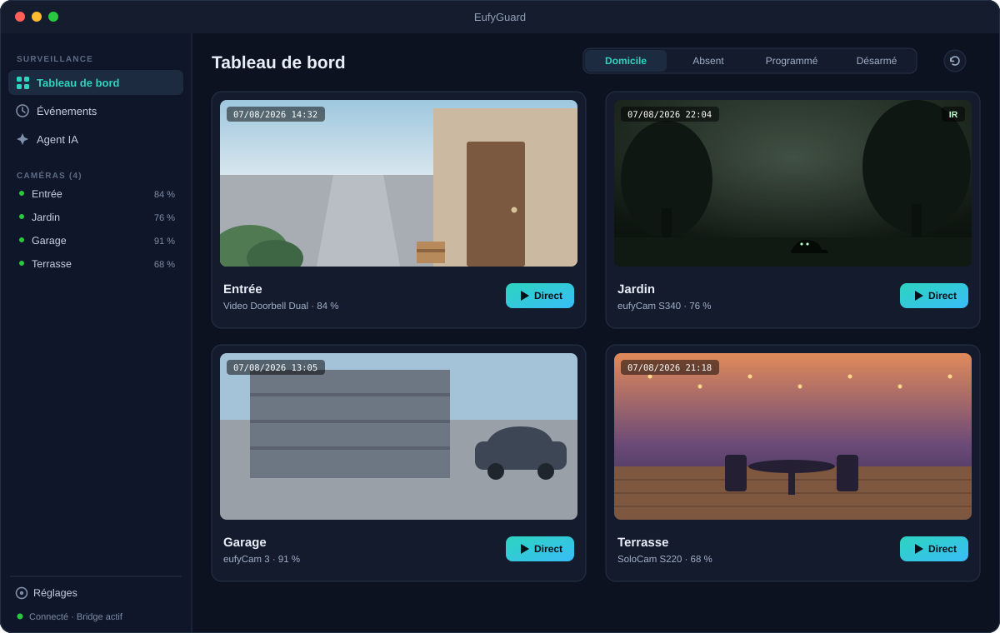
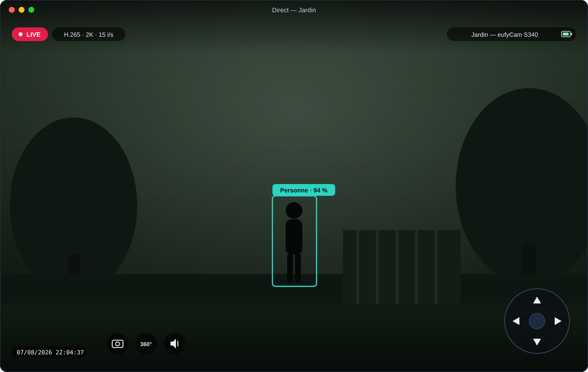
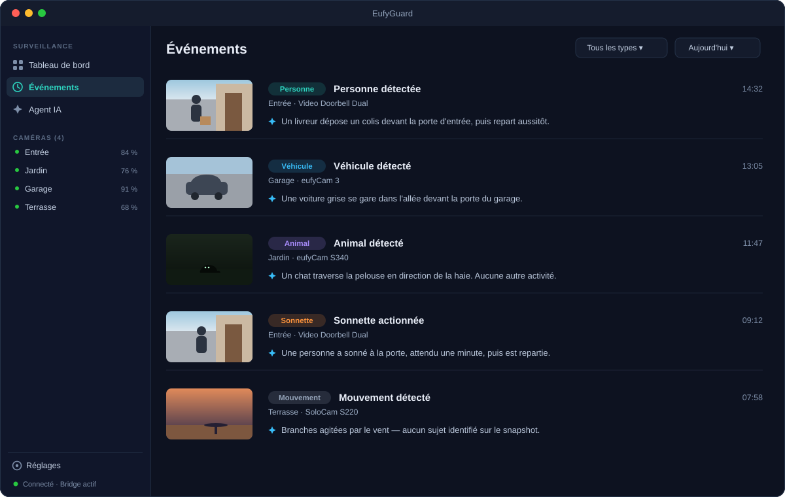
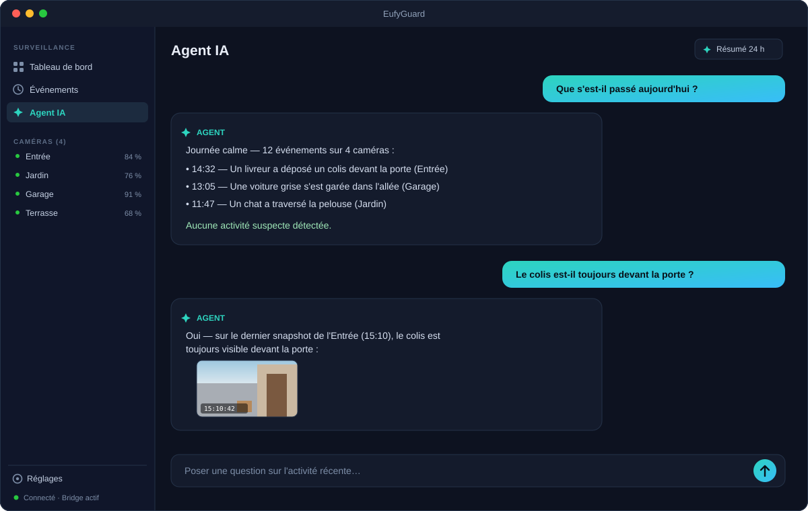

# EufyGuard

[](https://github.com/vincentlauriat/EufyGuard/releases/latest)

[](LICENSE)

Native macOS surveillance app for Eufy cameras, with a local AI monitoring agent.

EufyGuard is made of two cooperating processes: a SwiftUI app (dashboard, live
view, timeline, chat, notifications) and a local Node/TypeScript engine — the
*bridge* — that talks to the Eufy cloud and stations through
[`eufy-security-client`](https://github.com/bropat/eufy-security-client). The
app launches and supervises the bridge automatically; everything runs on your
Mac, on `127.0.0.1` only.

## Screenshots

> Illustrative mockups — no real camera footage is ever published.



| Live view, AI detection & PTZ | Event timeline | AI chat |
|---|---|---|
|  |  |  |

## Features

| Feature | Status |
|---|---|
| Camera dashboard with periodic snapshots | ✅ |
| Event timeline (motion, person, ring, pet, vehicle, package…) | ✅ |
| AI vision analysis of event snapshots (Claude, structured output) | ✅ |
| Native macOS notifications with alert levels | ✅ |
| Native live streaming (H.264 / H.265, hardware decoded) | ✅ |
| Guard mode control per station (home / away / schedule / disarmed) | ✅ |
| PTZ control on motorized cameras (pad, arrow keys, 360° sweep) | ✅ |
| AI chat grounded on the event log | ✅ |
| 24-hour AI digest report | ✅ |
| Captcha / two-factor login flows | ✅ |

## Install

Download the latest DMG from the
[Releases page](https://github.com/vincentlauriat/EufyGuard/releases/latest),
open it and drag EufyGuard to Applications. The app is signed and notarized,
and receives auto-updates via Sparkle.

## Requirements

- macOS 14 (Sonoma) or later.
- A Eufy account. Tip: create a secondary Eufy account dedicated to EufyGuard
  and share your devices with it, so you don't get logged out of the official
  app.
- Node.js ≥ 20 available at `/opt/homebrew/bin/node`, `/usr/local/bin/node` or
  `/usr/bin/node` — the app uses it to run the local bridge engine.
- Optional: an Anthropic API key (`sk-ant-…`) to enable the AI agent (vision
  analysis, chat, digest). Without a key, detection and notifications still
  work, just without AI analysis.

## Build from source

```bash
git clone https://github.com/vincentlauriat/EufyGuard.git
cd EufyGuard

# 1. Bridge (Node/TypeScript engine)
cd bridge
npm install
npm run build        # tsc → dist/

# 2. macOS app (requires Xcode and xcodegen)
cd ../app
xcodegen generate
xcodebuild -scheme EufyGuard -configuration Release build
```

Running the bridge by hand (the app also starts it automatically):

```bash
cd bridge && npm start        # serves http://127.0.0.1:8791
```

## Configuration

On first launch the Settings sheet opens automatically. Enter your Eufy email,
password and country code (e.g. `FR`), plus optionally your Anthropic API key,
then click "Enregistrer et connecter".

- If Eufy requests a **captcha**, the image appears in Settings — type the code
  and validate.
- If Eufy requests a **2FA code** (email/SMS), a dedicated field appears —
  enter the code and validate.

Credentials are sent to the local bridge only and stored in
`bridge/data/config.json` (file mode `0600`). They never leave your machine
except toward Eufy's own servers.

If your bridge checkout lives somewhere non-standard, point the app to it:

```bash
defaults write fr.lauriat.EufyGuard bridgePath /path/to/EufyGuard/bridge
```

## Project layout

```
EufyGuard/
├── app/                    # macOS SwiftUI app
│   ├── project.yml         # xcodegen project definition
│   └── Sources/
│       ├── EufyGuardApp.swift      # entry point
│       ├── ContentView.swift       # sidebar, dashboard, timeline
│       ├── ChatView.swift          # AI chat panel
│       ├── SettingsView.swift      # credentials, captcha, 2FA
│       ├── BridgeClient.swift      # HTTP/WS client for the bridge
│       ├── BridgeProcess.swift     # launches & supervises the bridge
│       ├── NotificationManager.swift
│       ├── Models.swift
│       └── Live/                   # livestream (WS → VideoToolbox)
├── bridge/                 # local Node/TypeScript engine
│   ├── package.json
│   ├── src/
│   │   ├── index.ts        # entry point, detection pipeline
│   │   ├── server.ts       # HTTP API + WebSocket (127.0.0.1:8791)
│   │   ├── eufy.ts         # eufy-security-client wrapper
│   │   ├── agent.ts        # Claude vision analysis + chat
│   │   ├── store.ts        # event persistence (events.json)
│   │   └── config.ts       # config.json, data directories
│   └── data/               # runtime data — never committed
├── docs/                   # architecture & API reference
├── LICENSE
└── README.md
```

## Architecture

```
┌─────────────────────────────┐        ┌──────────────────────────────┐
│  EufyGuard.app (SwiftUI)    │  HTTP  │  Bridge (Node/TypeScript)    │
│  - Dashboard (snapshots)    │◄──────►│  - eufy-security-client      │
│  - Live view (VideoToolbox) │   WS   │  - Event detection           │
│  - Event timeline           │        │  - Snapshot capture          │
│  - AI chat panel            │        │  - Claude vision analysis    │
│  - Native notifications     │        │  - Chat agent (Claude)       │
│  - Settings (credentials)   │        │  - API on 127.0.0.1:8791     │
│  - Launches/supervises node │        └──────────────┬───────────────┘
└─────────────────────────────┘                       │ P2P / cloud
                                                Eufy stations & cameras
```

The Eufy P2P protocol only has a mature open-source implementation in Node.js,
so the native app embeds a local Node engine and keeps all UI/UX native. See
[docs/ARCHITECTURE_EN.md](docs/ARCHITECTURE_EN.md) for the full picture and
[docs/BRIDGE_API.md](docs/BRIDGE_API.md) for the bridge API reference.

## Privacy

- Everything runs locally. The bridge binds to `127.0.0.1` only and is never
  exposed to the network.
- Eufy credentials and the Anthropic API key live in `bridge/data/config.json`,
  written by the app through the local API — never in the code, never
  committed (`bridge/data/` is git-ignored).
- Event history and snapshots are stored on disk in `bridge/data/`.
- The only outbound traffic is toward Eufy (account, P2P streams) and, if you
  enable the AI agent, the Anthropic API (event snapshots and the event log
  summaries are sent for analysis).

## Roadmap

- [ ] Livestream audio (AAC)
- [ ] Event video clips download
- [ ] Scheduled evening digest notification
- [ ] Low-battery alerts

## License

[MIT](LICENSE) — © 2026 Vincent Lauriat.
